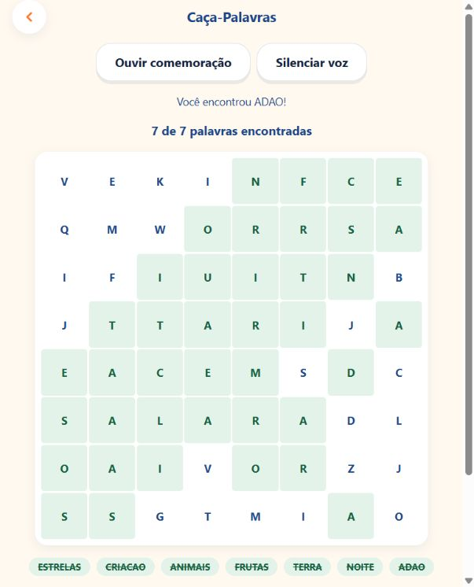

  
  <h1>Aprender a Bíblia brincando</h1>
  
Histórias narradas, descobertas e jogos para a criança participar da aprendizagem.

  
<a href="https://reinoup.com"><strong>Conheça o aplicativo</strong></a> · <a href="https://reinoup.com/app/historias">Explore as histórias</a> · <a href="https://github.com/agronetlabs/ReinoUp/issues/new/choose">Envie uma sugestão</a>

## Quem está construindo

O ReinoUp é desenvolvido por **Leandro Lemos**, à frente da **[AgroNet Labs](https://github.com/agronetlabs)**, com apoio de ferramentas de inteligência artificial na programação e na produção audiovisual.

Este espaço apresenta o produto, as decisões de experiência e sua evolução. Aqui você pode conhecer o trabalho, acompanhar melhorias e conversar diretamente com quem o constrói.

## Uma experiência para ouvir, explorar e jogar

A primeira história, **A Criação**, tem acesso gratuito. O Cordeirinho recebe a criança e acompanha uma jornada com imagens, narração e atividades interativas.

| Experiência | O que a criança encontra |
| --- | --- |
| Histórias bíblicas | Cenas audiovisuais, narração e legendas. |
| Jogos | Atividades como caça-palavras, memória e quebra-cabeça. |
| Desafios | Descobertas e tarefas com orientação narrada. |
| Recompensas | Talentos, progresso e um baú que celebra as conquistas. |
| Área dos pais | Um acesso separado para os responsáveis. |

A voz feminina **Clara**, usada nas interações dos jogos, também participa das celebrações. O objetivo é oferecer orientação que a criança possa ouvir enquanto brinca.

<table>
  <tr>
    <td align="center"> <strong>Nosso Cordeirinho</strong></td>
    <td align="center"> <strong>Celebrar cada conquista</strong></td>
  </tr>
</table>

## Melhorias que começam com quem usa

Os comentários recebidos viram ajustes verificáveis no aplicativo. Alguns exemplos:

- **Baú de Recompensas:** nova ilustração, comemoração narrada e redução de 20% do tamanho após avaliação no celular.
- **Saldo de talentos:** tocar no indicador agora abre um painel com a quantidade disponível e uma explicação das recompensas.
- **Caça-palavras:** seleção por arraste, mantendo a alternativa de tocar na primeira e na última letra, com orientação e comemoração narradas.

[Veja os três exemplos e como foram verificados →](docs/evolucao.md)

  
Veja uma partida concluída no caça-palavras

  

  
Captura de validação no navegador. A interface pode evoluir entre versões.

## Onde experimentar

- **Web:** [reinoup.com](https://reinoup.com).
- **PWA:** experiência web instalável em dispositivos compatíveis.
- **Android:** em fase de testes na Google Play. A distribuição aos participantes segue a liberação de cada versão na faixa de testes.

O lançamento público na Google Play ainda não é anunciado aqui. Esta apresentação foi atualizada em **30 de outubro de 2026**.

## Como é construído

O aplicativo usa **React e TypeScript**, com **Vite e Bun** no desenvolvimento, **Capacitor** na versão Android, **Supabase** nos serviços de backend e **Cloudflare** na hospedagem e entrega de mídia. A produção de voz utiliza **ElevenLabs**.

A inteligência artificial participa do processo de criação; as decisões de produto, revisão e publicação são conduzidas por Leandro. O ciclo de trabalho combina implementação, testes automatizados, revisão no navegador e verificações no Galaxy S24.

## Participe da evolução

Encontrou uma dificuldade ou tem uma sugestão? [Abra uma issue](https://github.com/agronetlabs/ReinoUp/issues/new/choose) descrevendo a tela, o que tentou fazer e o resultado esperado. Para falhas, informe também o dispositivo e se estava usando web, PWA ou Android.

Este repositório é público: não inclua dados de crianças, senhas ou informações pessoais nas mensagens e capturas. Consulte o [guia de participação](CONTRIBUTING.md).

## Sobre este repositório

Este é o **repositório público de apresentação do ReinoUp**. O código-fonte do aplicativo é mantido em um repositório privado. As imagens e a documentação aqui publicadas apresentam o projeto; não foi concedida uma licença de reutilização do aplicativo, da marca ou dos conteúdos.

**Desenvolvimento: Leandro Lemos · AgroNet Labs**  
[Aplicativo](https://reinoup.com) · [Perfil do desenvolvedor](https://github.com/agronetlabs)
